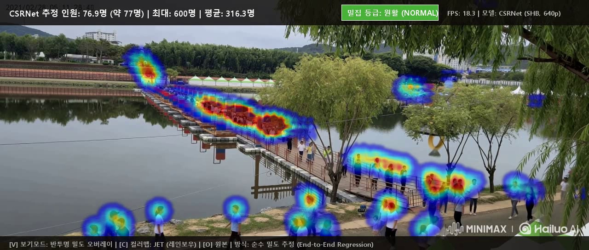

# CCTV 인파 밀집도 분석

녹화된 CCTV 영상에서 인원 수와 밀집도를 분석하고, 구역별 혼잡도를 JSON과 시각 자료로 확인하는 Python 컴퓨터 비전 프로젝트입니다.

## 프로젝트 개요

| 항목 | 내용 |
|---|---|
| 목적 | 행사장·공공장소 영상의 인파 규모와 혼잡 수준 분석 |
| 분석 방식 | CSRNet 밀도 맵 기반 인원 추정, YOLOv8 사람 객체 탐지 기반 배치 분석 |
| 시각화 | 분석 결과를 영상·그래픽으로 표현 |
| 기술 스택 | Python, PyTorch, Torchvision, OpenCV, Ultralytics YOLO, NumPy, SciPy, Pillow |
| 실행 형태 | 로컬 영상 파일을 처리하는 스크립트 |
| 저장·배포 | 결과를 로컬에 저장. 서비스 API, DB, 클라우드 배포 설정은 없음 |

## 분석 흐름

~~~mermaid
flowchart LR
    A[video/ 원본 CCTV 영상] --> B{분석 스크립트 선택}
    B --> C[CSRNet 밀도 맵·인원 추정]
    B --> D[YOLOv8 사람 검출·시간 샘플링]
    C --> E[혼잡 단계와 구역별 JSON]
    D --> E
    E --> F[시각화 스크립트]
    F --> G[output/ 분석 결과]
~~~

두 분석기는 서로 다른 모델과 혼잡도 임계값을 사용하므로 결과를 직접 같은 기준의 점수로 비교하지 않습니다.

## 상세 문서

- [분석 아키텍처와 알고리즘](docs/architecture/README.md)
- [설치·입력 영상·실행 방법](docs/development/README.md)
- [결과 해석과 개선 로드맵](docs/roadmap/README.md)

## 실제 추론 결과 화면

기존 CSRNet 분석 결과 영상에서 추출한 대표 프레임입니다. 원본 입력은 테스트용 생성 영상이며, 화면에는 인원 추정치·밀도 맵·ROI 구역·혼잡 단계가 표시됩니다.



- ROI 구역별 혼잡도: [실행 화면](docs/screenshots/cctv-02-roi-zone-density.jpg)
- 보행로 혼잡 단계와 인원 추정: [실행 화면](docs/screenshots/cctv-03-underpass-congestion.jpg)

## 설치 및 모델 가중치

```bash
pip install -r requirements.txt
```

- CSRNet 가중치는 `analyze_crowd.py` 실행 시 Hugging Face에서 자동으로 내려받거나 프로젝트 루트의 `CSRNet.pth`를 사용합니다.
- YOLOv8 가중치는 Ultralytics에서 자동으로 내려받거나 사용 가능한 로컬 가중치를 사용합니다.
- 대용량 모델 가중치 및 영상 파일은 `.gitignore`로 Git 추적에서 제외됩니다.

## 영상 폴더 구조

- `video/`: CSRNet·YOLO 분석 전 원본 영상만 보관합니다. 원활/혼잡 분류 폴더는 사용하지 않습니다.
- `output/`: 분석 JSON, 결과 영상, 원본·결과 대응표를 저장합니다.
- 통합한 기존 분석 결과 영상은 `analysis_result_NNN.mp4`이며, `output/video_manifest.csv`에서 원본 파일명, 결과 파일명, SHA-256을 확인할 수 있습니다.
- 이후 `visualize_crowd.py`는 `csrnet_video_analysis.mp4`로 저장하고 같은 이름이 있으면 순번을 붙여 기존 영상을 보존합니다.
- 같은 내용의 원본이 여러 폴더에 있으면 한 부만 `video/`에 두고, 중복 원본 정보는 매니페스트에 기록합니다.
- 영상별 CSRNet ROI는 `roi_config.json`에 유지합니다. 카메라 구도가 바뀌면 ROI를 다시 지정해야 하며, ROI가 없는 영상은 전체 화면을 분석합니다.

## 실행 방법

### CSRNet 인원 분석

```bash
python analyze_crowd.py
```

### YOLOv8 배치 분석

```bash
python batch_crowd_analysis.py
```

### CSRNet 밀도 시각화

```bash
python visualize_crowd.py
```

세 스크립트는 `video/`의 MP4를 읽고 JSON 또는 시각화 결과를 `output/`에 저장합니다.


## 검증 결과

2026-11-26 기준 네 분석 스크립트의 Python 컴파일 검사를 통과했습니다. 2026-11-22 기록된 입력 탐색 확인에서는 16개 영상이 발견됐고, CSRNet은 실제 영상 1개의 243프레임을 처리했습니다. 전체 영상의 일괄 재분석이나 모델 정확도 평가는 수행하지 않았습니다. 영상 조건과 ROI에 따라 추정 결과가 달라집니다.
